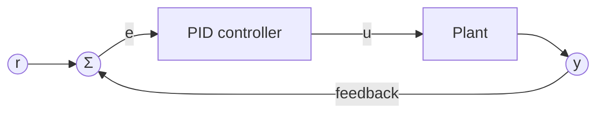

## The control law

A PID controller measures the error $e(t) = r(t) - y(t)$ between the reference $r$ and the measured output $y$, and combines three terms into the control signal:

$$
u(t) = K_p\, e(t) + K_i \int_0^t e(\tau)\,\mathrm{d}\tau + K_d\, \frac{\mathrm{d}e(t)}{\mathrm{d}t}.
$$

The proportional term reacts to the present error, the integral term removes steady-state error, and the derivative term damps fast changes.

## The feedback loop

## Tuning in one line

Raise $K_p$ until the response is fast but oscillates, add $K_d$ to damp the oscillation, then add a small $K_i$ to remove the offset.
