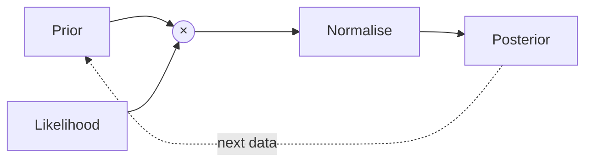

## The rule

The posterior over parameters $\theta$ after seeing data $\mathcal{D}$ combines what we believed before with how well each $\theta$ explains the data:

$$
p(\theta \mid \mathcal{D}) = \frac{p(\mathcal{D} \mid \theta)\, p(\theta)}{\int p(\mathcal{D} \mid \theta')\, p(\theta')\, \mathrm{d}\theta'}.
$$

## A coin example

With a $\mathrm{Beta}(a, b)$ prior on the probability of heads and $h$ heads in $n$ flips, the posterior is again a Beta distribution:

$$
\theta \mid \mathcal{D} \sim \mathrm{Beta}(a + h,\; b + n - h).
$$
