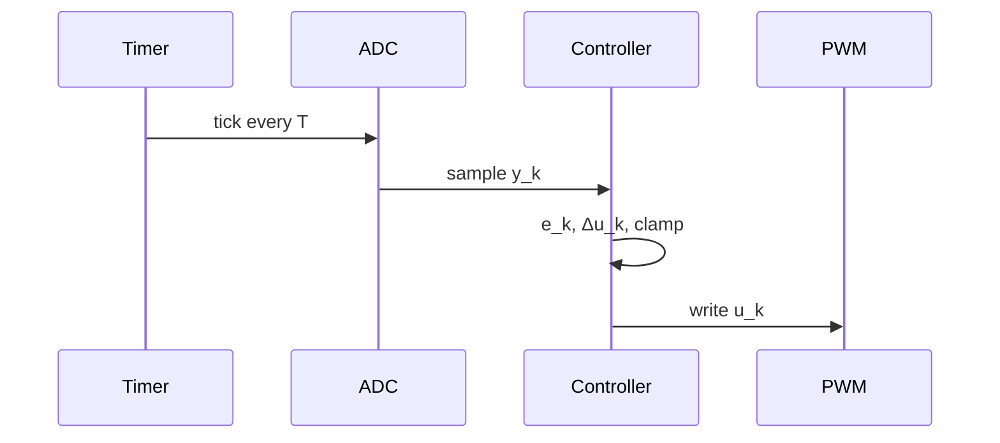

## Sampling the control law

With a sampling period $T$, the integral becomes a running sum and the derivative a backward difference:

$$
u_k = K_p\, e_k + K_i T \sum_{j=0}^{k} e_j + \frac{K_d}{T}\left(e_k - e_{k-1}\right).
$$

## The velocity form

Subtracting $u_{k-1}$ from $u_k$ removes the sum and avoids integrator wind-up when the output saturates:

$$
\begin{aligned}
\Delta u_k ={}& K_p\,(e_k - e_{k-1}) + K_i T\, e_k \\
&+ \frac{K_d}{T}\,(e_k - 2e_{k-1} + e_{k-2}).
\end{aligned}
$$

## One control period

