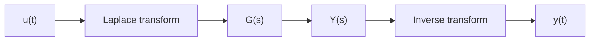

## From a differential equation

A mass $m$ on a spring $k$ with damping $c$, pushed by a force $u(t)$, obeys

$$
m\ddot{y}(t) + c\dot{y}(t) + k y(t) = u(t).
$$

## The transfer function

With zero initial conditions, the Laplace transform turns derivatives into powers of $s$, so the ratio of output to input is

$$
G(s) = \frac{Y(s)}{U(s)} = \frac{1}{m s^2 + c s + k}.
$$

## Reading stability from the poles

The poles are the roots of $m s^2 + c s + k = 0$. The system is stable when every pole has a negative real part, $\operatorname{Re}(p_i) < 0$.
