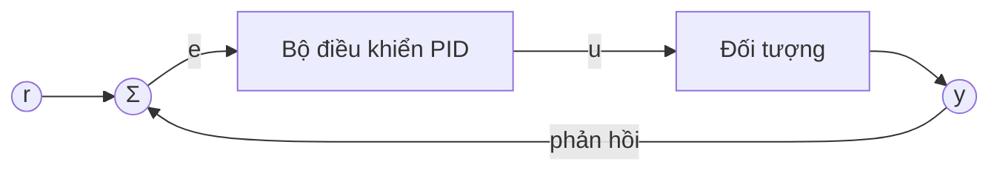

## Luật điều khiển

Bộ điều khiển PID đo sai lệch $e(t) = r(t) - y(t)$ giữa giá trị đặt $r$ và đầu ra đo được $y$, rồi kết hợp ba thành phần thành tín hiệu điều khiển:

$$
u(t) = K_p\, e(t) + K_i \int_0^t e(\tau)\,\mathrm{d}\tau + K_d\, \frac{\mathrm{d}e(t)}{\mathrm{d}t}.
$$

Thành phần tỉ lệ phản ứng với sai lệch hiện tại, thành phần tích phân loại bỏ sai lệch tĩnh, còn thành phần vi phân làm dịu các thay đổi nhanh.

## Vòng phản hồi

## Chỉnh tham số trong một câu

Tăng $K_p$ cho tới khi đáp ứng nhanh nhưng bắt đầu dao động, thêm $K_d$ để dập dao động, rồi thêm một chút $K_i$ để triệt tiêu sai lệch còn lại.
