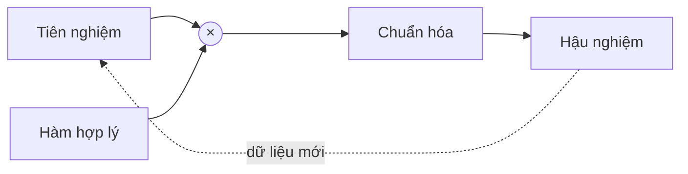

## Quy tắc

Phân phối hậu nghiệm của tham số $\theta$ sau khi quan sát dữ liệu $\mathcal{D}$ kết hợp điều ta tin từ trước với mức độ mỗi $\theta$ giải thích được dữ liệu:

$$
p(\theta \mid \mathcal{D}) = \frac{p(\mathcal{D} \mid \theta)\, p(\theta)}{\int p(\mathcal{D} \mid \theta')\, p(\theta')\, \mathrm{d}\theta'}.
$$

## Ví dụ đồng xu

Với tiên nghiệm $\mathrm{Beta}(a, b)$ cho xác suất ra mặt ngửa và $h$ lần ngửa trong $n$ lần tung, hậu nghiệm vẫn là một phân phối Beta:

$$
\theta \mid \mathcal{D} \sim \mathrm{Beta}(a + h,\; b + n - h).
$$
