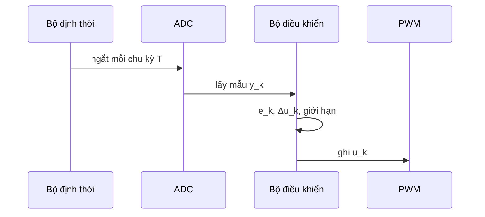

## Lấy mẫu luật điều khiển

Với chu kỳ lấy mẫu $T$, tích phân trở thành tổng tích lũy và đạo hàm trở thành sai phân lùi:

$$
u_k = K_p\, e_k + K_i T \sum_{j=0}^{k} e_j + \frac{K_d}{T}\left(e_k - e_{k-1}\right).
$$

## Dạng vận tốc

Lấy $u_k$ trừ $u_{k-1}$ sẽ loại bỏ tổng tích lũy và tránh hiện tượng bão hòa tích phân khi đầu ra chạm giới hạn:

$$
\begin{aligned}
\Delta u_k ={}& K_p\,(e_k - e_{k-1}) + K_i T\, e_k \\
&+ \frac{K_d}{T}\,(e_k - 2e_{k-1} + e_{k-2}).
\end{aligned}
$$

## Một chu kỳ điều khiển

