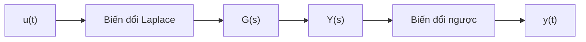

## Từ phương trình vi phân

Một khối lượng $m$ gắn với lò xo $k$ và bộ giảm chấn $c$, chịu lực tác động $u(t)$, tuân theo

$$
m\ddot{y}(t) + c\dot{y}(t) + k y(t) = u(t).
$$

## Hàm truyền

Với điều kiện đầu bằng không, phép biến đổi Laplace biến các đạo hàm thành lũy thừa của $s$, nên tỉ số giữa đầu ra và đầu vào là

$$
G(s) = \frac{Y(s)}{U(s)} = \frac{1}{m s^2 + c s + k}.
$$

## Đọc tính ổn định từ điểm cực

Các điểm cực là nghiệm của $m s^2 + c s + k = 0$. Hệ ổn định khi mọi điểm cực có phần thực âm, $\operatorname{Re}(p_i) < 0$.
