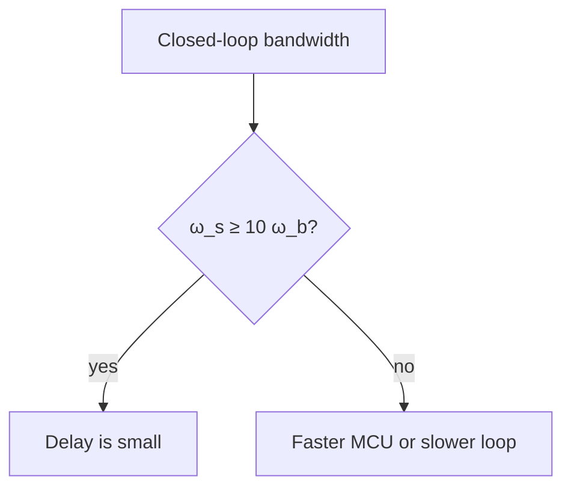

The Nyquist rate only says when a signal can be reconstructed. A control loop also loses phase to the sampling delay, so a common rule of thumb is to sample 10 to 30 times faster than the closed-loop bandwidth $\omega_b$:

$$
\omega_s = \frac{2\pi}{T} \approx (10 \text{ to } 30)\,\omega_b.
$$

