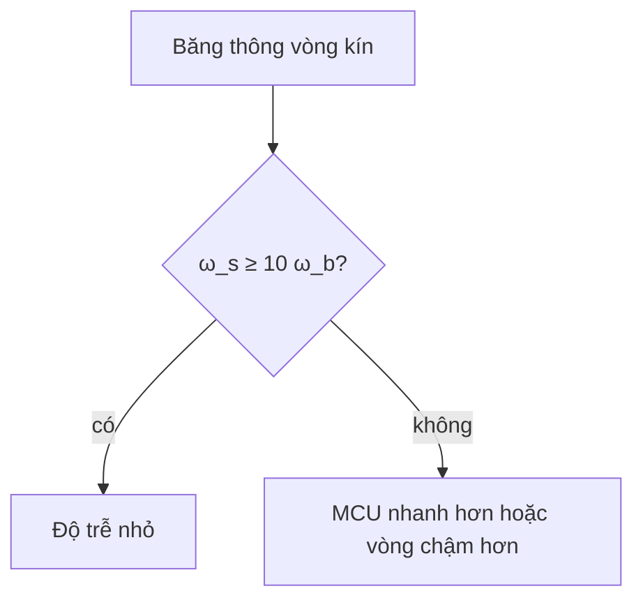

Tần số Nyquist chỉ cho biết khi nào một tín hiệu có thể được khôi phục. Vòng điều khiển còn mất pha do độ trễ lấy mẫu, nên quy tắc kinh nghiệm phổ biến là lấy mẫu nhanh hơn băng thông vòng kín $\omega_b$ từ 10 đến 30 lần:

$$
\omega_s = \frac{2\pi}{T} \approx (10 \text{ đến } 30)\,\omega_b.
$$

