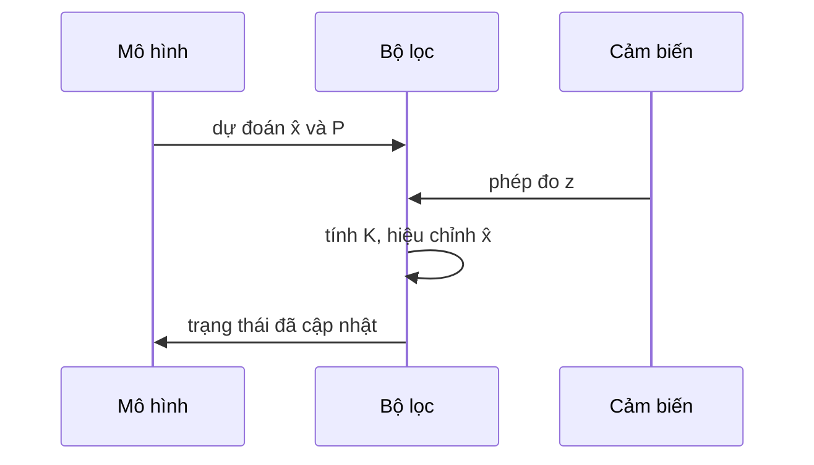

Nếu hệ là tuyến tính và nhiễu có phân phối Gauss, bộ lọc Kalman cho đúng phân phối hậu nghiệm của trạng thái. Mỗi bước gồm dự đoán, rồi hiệu chỉnh bằng phép đo mới $z_k$:

$$
\begin{aligned}
\hat{x}_{k\mid k} &= \hat{x}_{k\mid k-1} + K_k\left(z_k - H\hat{x}_{k\mid k-1}\right), \\
K_k &= P_{k\mid k-1} H^\top \left(H P_{k\mid k-1} H^\top + R\right)^{-1}.
\end{aligned}
$$

Chỉ nên dùng bộ lọc hạt hoặc bộ ước lượng học máy khi động học phi tuyến mạnh hoặc nhiễu khác xa phân phối Gauss.
