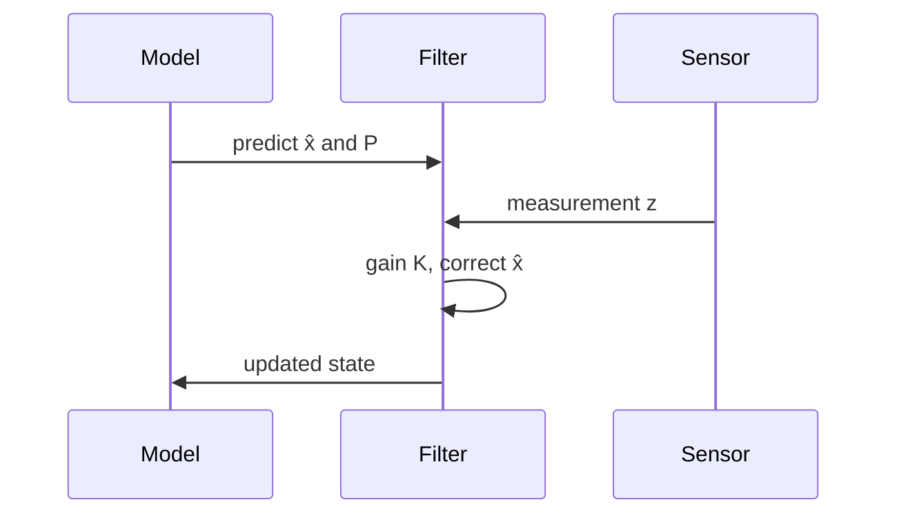

If the system is linear and the noise is Gaussian, the Kalman filter gives the exact posterior over the state. Each step predicts, then corrects with the new measurement $z_k$:

$$
\begin{aligned}
\hat{x}_{k\mid k} &= \hat{x}_{k\mid k-1} + K_k\left(z_k - H\hat{x}_{k\mid k-1}\right), \\
K_k &= P_{k\mid k-1} H^\top \left(H P_{k\mid k-1} H^\top + R\right)^{-1}.
\end{aligned}
$$

Reach for particle filters or learned estimators only when the dynamics are strongly nonlinear or the noise is far from Gaussian.
