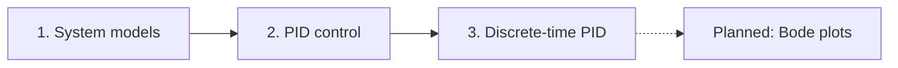

This placeholder series shows how a series page is organised: an overview, the learning objectives, the published parts in order and the parts still planned.

The series follows one thread, from a model of the plant to a controller running in discrete time:

Everything starts from the standard second-order system, whose behaviour is set by the damping ratio $\zeta$ and the natural frequency $\omega_n$:

$$
G(s) = \frac{\omega_n^2}{s^2 + 2\zeta\omega_n s + \omega_n^2}.
$$
