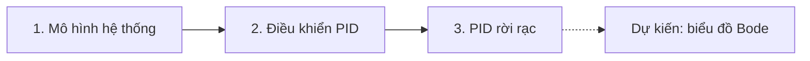

Chuỗi bài tạm này cho thấy một trang series được tổ chức thế nào: phần tổng quan, mục tiêu học tập, các bài đã đăng theo thứ tự và các bài còn dự kiến.

Chuỗi bài đi theo một mạch, từ mô hình đối tượng đến bộ điều khiển chạy trong miền rời rạc:

Mọi thứ bắt đầu từ hệ bậc hai tiêu chuẩn, có hành vi được quyết định bởi hệ số tắt dần $\zeta$ và tần số dao động riêng $\omega_n$:

$$
G(s) = \frac{\omega_n^2}{s^2 + 2\zeta\omega_n s + \omega_n^2}.
$$
