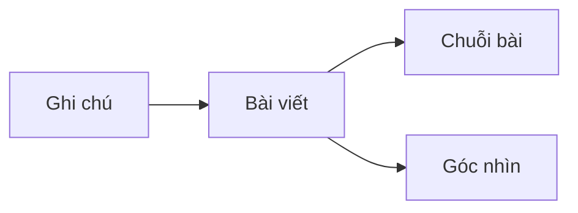

Nội dung trên trang đi qua ba giai đoạn. Trang đang được làm lại, nên mục này là nội dung tạm.

Một chuỗi gồm $n$ phần được đọc theo thứ tự: phần $k$ giả định người đọc đã đọc các phần $1, \dots, k-1$.
