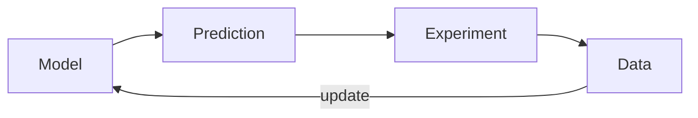

Every piece of work on ACRR follows the same loop: a model, a prediction, an experiment, and an update of the model from the data.

The update step is Bayes' rule, $p(\theta \mid \mathcal{D}) \propto p(\mathcal{D} \mid \theta)\, p(\theta)$.
