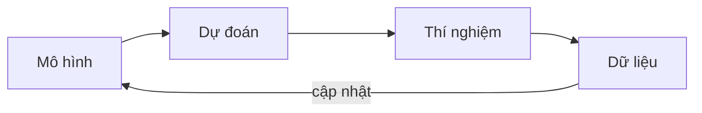

Mọi công việc trên ACRR đều theo cùng một vòng lặp: một mô hình, một dự đoán, một thí nghiệm, và cập nhật mô hình từ dữ liệu.

Bước cập nhật chính là quy tắc Bayes, $p(\theta \mid \mathcal{D}) \propto p(\mathcal{D} \mid \theta)\, p(\theta)$.
